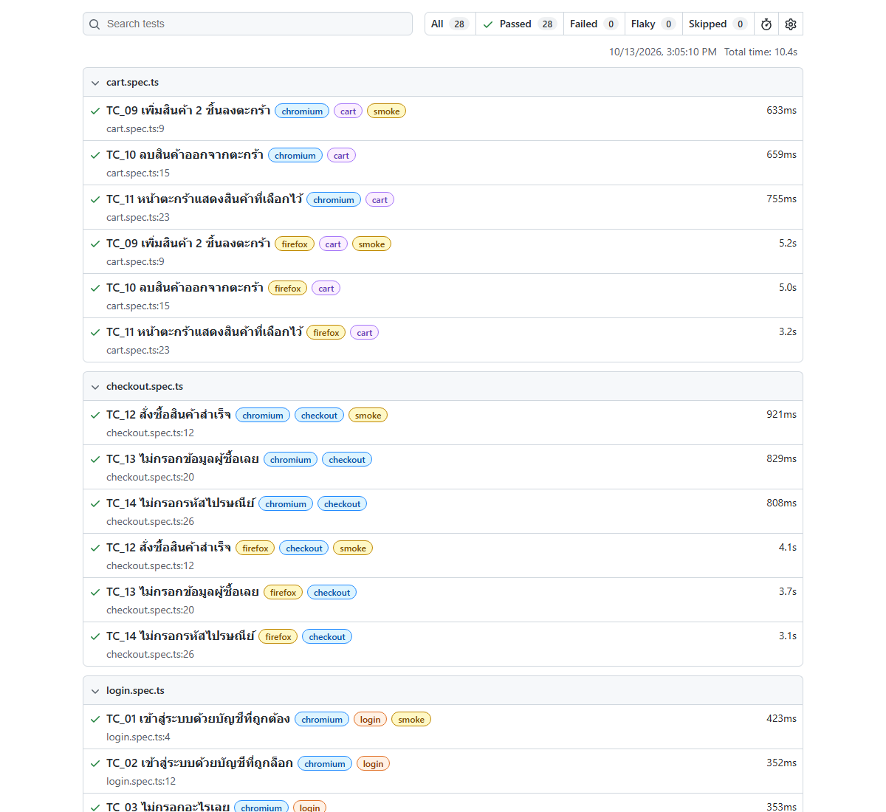

# Web Test Automation with Playwright


Hi, I'm Natthaphon. This project has UI tests for [Sauce Demo](https://www.saucedemo.com), a practice shop made by Sauce Labs, written with Playwright and TypeScript.

I tried to keep the tests easy to read. Each test is a few lines of steps followed by `expect` checks, and every element lives in the page object under `el`, for example `loginPage.el.errorMessage`.

```ts
test('TC_03 ไม่กรอกอะไรเลย', { tag: ['@login'] }, async ({ loginPage }) => {

  await loginPage.goto(users.url_website);
  await loginPage.loginWithoutData();
  await expect(loginPage.el.errorMessage).toHaveText('Epic sadface: Username is required');
});
```

## Test cases

14 test cases, each one runs on Chromium and Firefox.

| TC | Test | Tags |
|---|---|---|
| TC_01 | log in with a valid account | login, smoke |
| TC_02 | log in with a locked account | login |
| TC_03 | click login without filling anything | login |
| TC_04 | username without password | login |
| TC_05 | wrong password | login |
| TC_06 | product page shows 6 products | products, smoke |
| TC_07 | sort by name Z to A | products |
| TC_08 | sort by price low to high | products |
| TC_09 | add 2 products to cart | cart, smoke |
| TC_10 | remove a product from cart | cart |
| TC_11 | cart page shows the selected products | cart |
| TC_12 | complete an order | checkout, smoke |
| TC_13 | continue checkout without customer info | checkout |
| TC_14 | checkout without postal code | checkout |



## Project structure

```
data/users.ts         URL, test accounts and customer info
pages/                one class per page, plus fixtures.ts
tests/                login, products, cart and checkout tests
playwright.config.ts
```

- **Page objects with `el`**: locators are grouped in `this.el` so tests read like `productsPage.el.cartBadge`. Actions like `login()` or `fillInformation()` are methods on the page.
- **Fixtures**: `pages/fixtures.ts` passes the page objects straight into each test, so there's no `new LoginPage(page)` in every test.
- **`data-test` locators**: Sauce Demo has `data-test` on its elements, so I set `testIdAttribute: 'data-test'` and use `getByTestId()`.
- **Tags**: run a group with `--grep @smoke` or `--grep @cart`.

## Running it

Needs Node.js 20+.

```bash
npm install
npx playwright install
```

```bash
npx playwright test
```

Only smoke tests:

```bash
npx playwright test --grep @smoke
```

With the browser window open:

```bash
npx playwright test --headed --project=chromium
```

Open the report:

```bash
npx playwright show-report
```

## CI

GitHub Actions runs all tests on every push and uploads the HTML report as an artifact.
